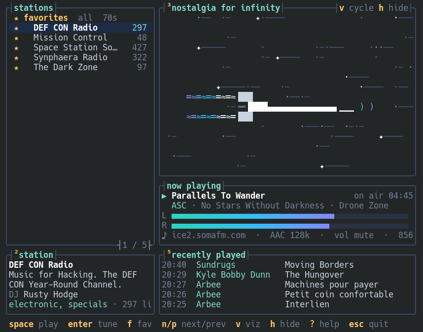

# Lighthugger TUI

A terminal player for [SomaFM](https://somafm.com/) internet radio, in the style of btop,
with a visualizer that moves on the audio you are hearing. The terminal sibling of the
KDE app [Lighthugger](https://github.com/mrdfuse/lighthugger).

> Unofficial app, not affiliated with SomaFM. SomaFM is listener-supported:
> please consider [supporting them](https://somafm.com/support/).

## Features

- All stations with listener counts, station details, now playing and recently played
- Four visualizers: the lighthugger *Nostalgia for Infinity* flying through a starfield
  (exhaust on the bass, radio waves on the level), spectrum, mirror and waveform
- Hide the visualizer with `h`; panels also drop away by themselves when the terminal is small
- Favorites shared with the KDE app, filters per genre, and search
- Stream quality from MP3 128k down to AAC+ 32k, with fallback to mirror servers

## Install (Arch, CachyOS, EndeavourOS, …)

    git clone https://github.com/mrdfuse/lighthugger-tui.git
    cd lighthugger-tui/packaging
    makepkg -si

Elsewhere: install Rust, ffmpeg and the ALSA development files, then `cargo build --release`.
PipeWire and PulseAudio work through their ALSA compatibility layer.

## Usage

    lighthugger-tui [--no-viz] [--mute] [station-id]

For example `lighthugger-tui dronezone`.

| Key | Action |
| --- | --- |
| `space` | play or stop |
| `enter` | tune in to the selected station |
| `↑ ↓` `j k` | select, `PgUp` `PgDn` `g` `G` to jump |
| `n` `p` | next or previous favorite |
| `f` | add or remove favorite |
| `tab` | favorites, all, or a genre |
| `/` | search, `esc` clears it |
| `s` | sort by name or listeners |
| `q` | stream quality |
| `← →` `+ -` | volume, `m` to mute |
| `v` | next visualizer |
| `h` or `3` | hide or show the visualizer |
| `2` `5` | hide or show station info, history |
| `r` | reload stations |
| `?` | help |
| `esc` | quit |

## How it works

ffmpeg decodes the stream to raw samples. The app sends those to the sound card and runs
an FFT over the samples being played, so the visualizer follows the audio without tapping
the system output.

Favorites live in `~/.config/lighthugger/lighthugger.conf`, the file of the KDE app, and
changes made there show up within seconds. The KDE app only reads that file when it starts,
so if both run at once, its next change to the favorites overwrites what the terminal added.
Everything else is in `~/.config/lighthugger/tui.conf`.

## License

MIT
